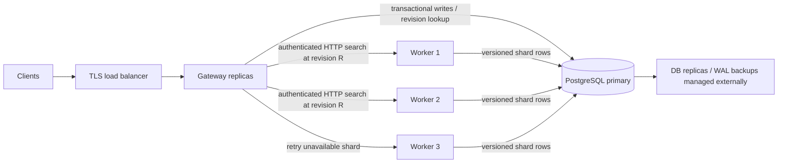

# Distributed architecture

## Components and data placement

| Component | Owns | Scales through |
|---|---|---|
| Gateway | No persistent state; API validation and global top-k merge | More replicas behind a load balancer |
| Worker | Disposable immutable Rust indexes and payload caches | More configured worker URLs; CPU/RAM per node |
| PostgreSQL | All vector versions, payloads, schemas, committed revisions, idempotency keys | Database sizing, HA/replication and backups operated separately |
| Load balancer / service mesh | TLS, optional identity/rate policies | Existing infrastructure |

There is no custom leader election or peer replication protocol. PostgreSQL's
transaction engine arbitrates writes; HA failover is the database provider's
responsibility. Do not run independent writable database primaries behind the
same connection endpoint. Workers never vote on or acknowledge writes.

## Shards and routing

Every collection fixes a dimension and a shard count when created. IDs map to
`uint64_be(SHA256(UTF8(id))[0:8]) % shard_count`. Unlike Python's process-randomized
hash, this is stable across languages/restarts. Shards are logical partitions in
one PostgreSQL table; this release does not physically shard the database.

For each `(collection, shard)`, gateways sort the configured worker URLs by
SHA-256 rendezvous score. The highest-ranked worker gets the first request.
Failure tries the next URL. Every worker can reconstruct any shard, so an old
gateway membership list during a rollout cannot create two divergent data
owners. No data copy is required when adding compute nodes; caches warm lazily.
Changed membership can temporarily duplicate caches and increase database load.

Search always visits **every shard**. Approximate tree/HNSW routing occurs
inside a shard. Each shard returns up to k scored hits; merging these lists is
sufficient for global exact top-k when each shard search is exact. ANN search
can miss neighbors within a shard. Results use cosine scores, not routing
weights. Merge orders score descending then ID; equal-score cutoff membership
inside the native engine can differ with index layout.

## Write protocol

1. Client sends a mutation batch and `Idempotency-Key` to any gateway.
2. Gateway authenticates, bounds request size and validates IDs/vectors.
3. One database transaction locks the collection row (`SELECT FOR UPDATE`).
4. A matching stored key/digest returns the original revision. A different
   digest with the same key fails with 409. Otherwise validate dimensions.
5. Allocate the next collection revision R, close previous versions of affected
   IDs with `valid_to=R`, and insert new upsert rows with `valid_from=R`.
   Delete only closes the current version; deleting an absent ID is valid.
6. Save the idempotency result and new collection revision in the same commit.
7. Reply only after commit. A disconnect during commit has an uncertain client
   outcome: retry the identical batch with the identical key to resolve it.

The entire batch is atomic across its shards. Independent collections may write
concurrently; writes to one collection serialize. Revisions are collection
local and monotonically increasing. Upserts replace the full vector/payload.
This is not a patch API. Idempotency records are retained without expiry.

## Read protocol and consistency

The gateway fetches the latest committed revision R from the primary once,
then sends R to every worker. A worker loads versions satisfying
`valid_from <= R AND (valid_to IS NULL OR valid_to > R)`. A newer write closes
an interval at a revision greater than R, so it cannot alter that read's
logical contents. Payloads and vectors come from the same version row.

All shards therefore represent one collection snapshot even across concurrent
writes or worker retries. A search begun after a write acknowledgment includes
that write (unless superseded by a later write). Use the **primary** database
endpoint for gateways and workers; asynchronous read replicas are unsupported.
There is no transaction spanning collections and no public historical-read API.

Workers cache `(collection, shard, revision)` entries. A single build lock per
worker prevents concurrent index construction; published engines are immutable.
In-flight readers retain a reference if an entry is evicted. Restarting a worker
discards the cache; it reconstructs from authoritative rows on its next query.

## Failure behavior

| Failure | Behavior |
|---|---|
| Gateway dies before database commit | Transaction rolls back when DB connection ends |
| Gateway dies after commit, before reply | Same idempotency key recovers original result |
| Worker disappears | Gateway tries another configured worker |
| Worker rebuild exceeds deadline | Search fails or retries; old build may finish and warm cache |
| All workers fail for one shard | Entire search returns 503, never silent partial results |
| Overall fan-out deadline expires | 504; pending outbound tasks cancelled |
| PostgreSQL unavailable | Writes and fresh searches fail; no stale-cache read bypass |
| Database primary fails | Provider/operator must restore one writable primary; durability depends on DB replication policy |
| Invalid request / over capacity | 422 / 413 / 429; structured JSON error |

HTTP retries are read-only. There is no automatic mutation retry hidden inside
the service. The caller owns retry policy and must reuse idempotency keys.
HTTP peer tokens authenticate workers/gateways; use TLS/mTLS infrastructure
for encryption and peer identity in production.

## Limits

- **This is a first release, not a proven large-scale production system.** No
  published throughput, latency, availability or recall SLO is claimed.
- Database storage and write throughput are centralized. There is no automatic
  database sharding, distributed consensus implementation, or cross-region
  active-active support.
- A collection revision invalidates cache keys even for unchanged shards.
  Each cache miss loads a shard and synchronously rebuilds its Rust index.
  This favors bulk ingestion/read-heavy use; sustained updates need immutable
  segments, shard-local revision tracking and background compaction.
- Historical versions and idempotency rows grow indefinitely. Automatic GC is
  deliberately absent: deleting versions still referenced by an in-flight
  snapshot would break correctness. Capacity-plan PostgreSQL, archive externally,
  and use maintenance-window export/re-ingest to a new database when necessary.
- Collection dimension/shard count/build settings are immutable. Re-sharding
  means creating a new collection and re-ingesting during a coordinated cutover.
  No online resharding, collection aliases or collection-drop endpoint exists.
- Each shard must fit worker memory. Row/vector limits bound an individual
  build, not total RSS. Python row objects, payloads, native graphs, temporary
  build arrays, cached shards and concurrent readers all consume additional RAM.
- No tenant RBAC, per-tenant quotas, metadata filtering, hybrid text search,
  vector quantization or embedding generation is provided. One API key grants
  cluster-wide access. Use isolated deployments for separate trust boundaries.
- Membership is explicit configuration; Kubernetes replicas must be changed
  through Helm so gateways learn the updated URL list. No gossip, operator,
  health-based service registry, speculative hedging or autoscaling worker pool.
- Health readiness checks database/schema connectivity, not warmed indexes or
  the availability of all worker URLs. Deploy a synthetic search monitor.

## Design references

PostgreSQL [transaction isolation](https://www.postgresql.org/docs/current/transaction-iso.html)
and [explicit locking](https://www.postgresql.org/docs/current/explicit-locking.html)
describe the primitives used here. Logical application versions provide the
cross-request snapshot; the service does not export long-lived database snapshots.
Kubernetes [disruptions](https://kubernetes.io/docs/concepts/workloads/pods/disruptions/)
explains why PDBs alone do not guarantee availability during controller rollouts.
